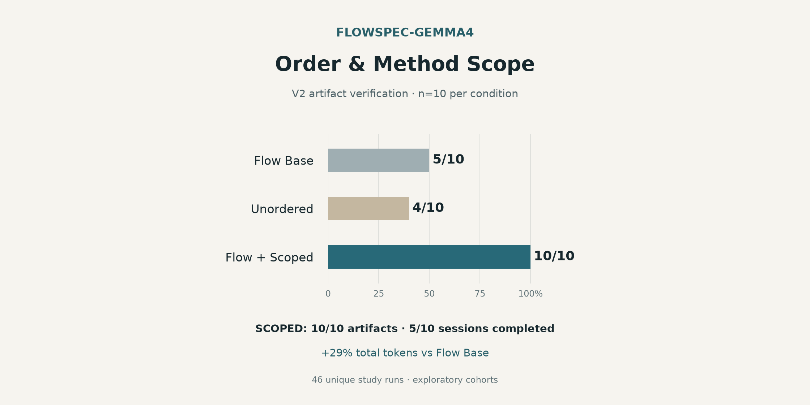

# FlowSpec-Gemma4: Execution Order and Method Scope

> **Transactional code generation with a local Gemma 4 coding agent**
> 46 unique study runs; 30 follow-up observations across three conditions.



- [English paper — revised Kaggle submission](docs/kaggle_gemma4_paper_en.md)
- [Korean paper](docs/kaggle_gemma4_paper_ko.md)
- [Per-run follow-up evidence and cohort notes](docs/scope_followup_results.md)
- [Recomputed follow-up audit](research/outputs/scope_followup_audit.json)
- [Original n=3 summary](research/outputs/ablation_and_repetitions_summary.json)
- [Kaggle writeup](https://www.kaggle.com/competitions/gemma-4-developer-agent-paper/writeups/new-writeup-1792105362437)

## 1. Latest Findings: Correct Artifacts and Completed Sessions

We evaluate design specifications for Python/SQLite reservation backends using a local two-stage Designer/Coder harness. The reported model is **Gemma 4 31B-IT (`Q4_K_M`, llama.cpp)** at `temperature=0.2`, with a `12,288`-token context. V1 has 2 tables, 5 operations, and 6 requirements; V2 has **7 tables, 13 operations, and 8 requirements**. V2 uses a 15-step budget.

The initial study covered 22 runs. A follow-up added 24 runs and reused six initial observations: **30 follow-up observations, 46 unique study runs overall**. Re-running the external verifier on all 30 artifacts reproduced these results:

| V2 condition | n | Full 8/8 pass | REQ-8 pass | Status filter in replay lookup | Harness completed |
| :--- | ---: | :---: | :---: | :---: | :---: |
| Flow Base: numbered steps | 10 | 5/10 (50%) | 5/10 | 5/10 | 8/10 |
| Unordered: unnumbered shuffled rules | 10 | 4/10 (40%) | 4/10 | 6/10 | 10/10 |
| Flow + Scoped: explicit method boundary | 10 | 10/10 (100%) | 10/10 | 0/10 | 5/10 |

**Main observation:** stating that `create_booking` must return an existing booking regardless of status coincides with removal of a recurring `status='CONFIRMED'` filter from its idempotency lookup. That filter incorrectly excludes cancelled bookings. Scope text reserves the `CONFIRMED` eligibility check for rescheduling/cancellation.

**Cost and completion:** Scoped averages 119,054 total tokens versus 92,001 for Flow Base (about +29%). Five scoped sessions exhaust the 15-step budget while leaving code that passes 8/8. Artifact correctness therefore differs from agent-session completion. See paper Tables 4–5 for Coder-only costs and sample standard deviations.

**Interpretation:** these data support explicit method boundaries as a candidate intervention on this task. They do not prove deterministic reliability or a general ordering advantage. Flow r1–r3 use separately generated designs; r4–r10 freeze r1. Scoped includes an earlier successful pilot and adds bilingual repeated semantic guidance. `Unordered + Scoped` remains future work. The [paper](docs/kaggle_gemma4_paper_en.md) documents configuration differences, sampling limits, and uncertainty.

## 2. Initial 22-Run Study (Historical Tables 1–3)

### Table 1: Small-Scale Task (V1 — 2 Tables, 5 Public Methods, 6 Requirements)

| Condition | Status | Design In | Design Out | Design Time | Steps (Tools) | Impl In | Impl Out | Total Tokens | Total Time | Agent Pytest | Standard Verify |
| :--- | :--- | :---: | :---: | :---: | :---: | :---: | :---: | :---: | :---: | :---: | :---: |
| **Cond 0-Pure (`No Design`)** | `completed` | 0 | 0 | 0.0s | 9 (8) | 44,221 | 5,648 | 49,869 | 8.7m | 10/10 | **6/6** |
| **Cond 1 (`Free-Form Prose`)** | `step_limit` | 1,271 | 2,035 | 173.6s | 15 (15) | 67,215 | 8,973 | 79,494 | 17.8m | 10/12 | **6/6*** |
| **Cond 2 (`Static Contracts`)** | `completed` | 1,308 | 2,547 | 217.9s | 11 (10) | 50,205 | 16,036 | 70,096 | 27.9m | 11/11 | **6/6** |
| **Cond 3 (`State Invariants`)** | `step_limit` | 1,328 | 2,663 | 230.0s | 15 (15) | 84,413 | 19,091 | 107,495 | 39.0m | 0/11† | **6/6** |
| **Cond 4-Flow (`Execution Flow`)** ⭐ | `completed` | 1,715 | 2,009 | 172.5s | **7 (6)** | **24,142** | **5,353** | **33,219** | **10.5m** | 8/8 | **6/6** |
| **Cond 5 (`Profiled Flow`)** | `step_limit` | 1,409 | 2,501 | 241.2s | 15 (15) | 65,576 | 6,826 | 76,312 | 17.5m | 0/12‡ | 0/6 (6/6‡) |

*\*V1 `Cond 1` cached `self._conn` at Step 14 (`6/6`) but left an unimported `CounselingError` on duplicate cancellation (`10/12` agent tests). †V1 `Cond 3` passed `6/6`, but its test file imported `BookingVerificationError` while the engine raised `PermissionError`. ‡V1 `Cond 5` called both `self._initialize_db()` (line 7) and `self._init_db()` (line 8) in `DatabaseManager.__init__` while only defining `def _init_db(self):` (`6/6` once line 7 is removed).*

### Table 2: Large-Scale Task Initial Sweep (V2 — 7 Coupled Tables, 13 Public Methods, 8 Requirements, `r1`)

| Condition | Status | Design In | Design Out | Design Time | Steps (Tools) | Impl In | Impl Out | Total Tokens | Total Time | Agent Pytest | Standard Verify | Failed Reqs |
| :--- | :--- | :---: | :---: | :---: | :---: | :---: | :---: | :---: | :---: | :---: | :---: | :--- |
| **Cond 0-Pure (`Direct`)** | `completed` | 0 | 0 | 0.0s | 6 (5) | 30,999 | 12,383 | 43,382 | 19.3m | 8/8 | 7/8 | `REQ-8` |
| **Cond 0-Min (`Unprimed`)** | `completed` | 3,967 | 2,537 | 261.9s | 7 (5) | 42,005 | 15,389 | 63,898 | 28.2m | 8/8 | 7/8 | `REQ-8` |
| **Cond 1 (`Free-Form Prose`)** | `step_limit` | 4,014 | 2,542 | 212.9s | 15 (14) | 105,782 | 25,892 | 138,230 | 42.1m | 6/8 | 6/8 | `REQ-5, REQ-7` |
| **Cond 2 (`Static Contracts`)** | `completed` | 4,091 | 2,068 | 190.1s | 12 (11) | 80,475 | 39,609 | 126,243 | 59.5m | 8/8 | 7/8 | `REQ-8` |
| **Cond 3 (`State Invariants`)** | `completed` | 4,135 | 2,141 | 180.3s | 7 (5) | 41,439 | 19,854 | 67,569 | 31.3m | 8/8 | 7/8 | `REQ-8` |
| **Cond 4-Flow (`Execution Flow`)** ⭐ | `completed` | 4,501 | 1,547 | 285.8s | 10 (8) | 63,150 | 16,134 | 85,332 | 28.3m | 8/8 | **8/8** | **None (100%)** |
| **Cond 5 (`Profiled Flow`)** | `step_limit` | 4,329 | 1,353 | 116.2s | 15 (15) | 96,795 | 54,413 | 156,890 | 79.1m | —§ | 7/8 | `REQ-8` |

*§V2 `Cond 5` experienced repeated output truncations and compactions (`54,413` coder output tokens), reaching Step 15 before creating `test_counseling.py`; its `counseling_engine.py` passes `7/8`.*

### Table 3: Large-Scale Task Multi-Run Stability & Information-Controlled Ablation (`n = 3` per Group)

| Group (`n = 3` on Large-Scale V2) | Per-Run Verify (`r1, r2, r3`) | Mean Verify | `8/8` (`REQ-8`) Pass Rate | Impl Steps | Impl Out Tokens | Total Tokens | Total Time |
| :--- | :---: | :---: | :---: | :---: | :---: | :---: | :---: |
| **`Cond 0-Pure` (Direct, 0 design tok)** | `7/8, 7/8, 7/8` | `7.00 ± 0.00` | `0/3 (0.0%)` | `10.00 ± 4.58` | `25,775 ± 19,505` | `83,419 ± 49,236` | `40.6 ± 30.7m` |
| **`Cond 3 Invariant` (2-stage)** | `7/8, 1/8, 1/8` | `3.00 ± 3.46` | `0/3 (0.0%)` | `12.33 ± 4.62` | `27,626 ± 7,784` | `122,799 ± 48,024` | `46.4 ± 15.4m` |
| **`Cond 4-Unordered` (Fixed Shuffled)** | `8/8, 7/8, 7/8` | `7.33 ± 0.58` | `1/3 (33.3%)` | `9.33 ± 4.16` | `22,653 ± 10,584` | `88,325 ± 42,688` | `34.4 ± 16.2m` |
| **`Cond 4-Flow` (`Step 1..N`)** ⭐ | **`8/8, 7/8, 8/8`** | **`7.67 ± 0.58`** | **`2/3 (66.7%)`** | **`8.67 ± 1.15`** | **`16,560 ± 418`** | **`83,878 ± 3,302`** | **`30.9 ± 3.0m`** |

---

## 3. Repository Structure & Study Artifact Index

### Core Directories

- [`docs/kaggle_gemma4_paper_en.md`](docs/kaggle_gemma4_paper_en.md) — Revised English submission paper, including the 30-observation follow-up.
- [`docs/kaggle_gemma4_paper_ko.md`](docs/kaggle_gemma4_paper_ko.md) — 1:1 Korean translation of the submission paper.
- [`research/briefs/`](research/briefs/) — Benchmark task requirements:
  - [`brief_v1.md`](research/briefs/brief_v1.md): Small-Scale Task (V1 — 2 tables, 5 public methods, `REQ-1`–`REQ-6`).
  - [`brief_v2_counseling_large.md`](research/briefs/brief_v2_counseling_large.md): Large-Scale Task (V2 — 4 subsystems, 7 coupled tables, 13 public methods, `REQ-1`–`REQ-8`).
- [`research/conditions/track2/`](research/conditions/track2/) — Condition prompt definitions (`no_design.md`, `cond1_generic.md`, `cond2_contract.md`, `cond3_invariant.md`, `cond4_flow.md`, `cond4_unordered.md`, `cond5_profiled.md`).
- [`research/inputs/design_spec_cond4_unordered.json`](research/inputs/design_spec_cond4_unordered.json) — Frozen information-controlled shuffled specification (`Cond 4-Unordered`) derived from `Cond 4-Flow` (`r1`).
- [`research/outputs/ablation_and_repetitions_summary.json`](research/outputs/ablation_and_repetitions_summary.json) — Complete per-run and group-level (`n = 3`) telemetry and `REQ-1`–`REQ-8` verification results.
- [`scripts/inspect_servers.py`](scripts/inspect_servers.py) — Standard Verification Suite (`REQ-1`–`REQ-6` for V1; `REQ-1`–`REQ-8` for V2) and multi-port interactive web inspection dashboard (ports `8100`–`8125`).
- [`scripts/run_ablation_and_repetitions.py`](scripts/run_ablation_and_repetitions.py) — Automation and aggregation script for `Cond 0-Pure`, `Cond 4-Unordered`, and `n = 3` repetitions.
- [`src/gemma_agent/`](src/gemma_agent/) — Core two-stage local agent harness and five workspace-jailed tools (`list_files`, `read_file`, `write_file`, `replace_text`, `run_tests`).

### Initial Study Index: Mapping Tables 1–3 to 22 Runs

Study run directories under [`research/runs/`](research/runs/) preserve `metadata.json`, `design/design_spec.json` and `design/.agent/trace.jsonl` (when Stage 1 is enabled), `implementation/counseling_engine.py`, `implementation/.agent/trace.jsonl`, and `metrics/` (`implementation.json`, `total.json`, and `design.json` when Stage 1 ran). Fixed-design observations skip Designer calls; stage failures are preserved rather than excluded.

The [follow-up appendix](docs/scope_followup_results.md) maps all 30 follow-up observations to artifacts and the [cohort manifest](research/inputs/scope_followup_cohort.json) records six reused observations. There are **46 unique study runs**; the repository also contains other harness experiments outside this study.

#### Small-Scale Task (V1 — Table 1, 6 Runs)

| # | Condition (Table 1) | Run Directory (`research/runs/...`) | Steps (Tools) | Total Tokens | Standard Verify |
| :-: | :--- | :--- | :---: | :---: | :---: |
| 1 | **V1 `Cond 0-Pure`** | [`20261012T111933Z_track2_no_design_r001_d53d733a`](research/runs/20261012T111933Z_track2_no_design_r001_d53d733a) | 9 (8) | 49,869 | **6/6** |
| 2 | **V1 `Cond 1`** | [`20261013T115013Z_track2_cond1_generic_r001_c96880ae`](research/runs/20261013T115013Z_track2_cond1_generic_r001_c96880ae) | 15 (15) | 79,494 | **6/6*** |
| 3 | **V1 `Cond 2`** | [`20261013T122410Z_track2_cond2_contract_r001_38979f94`](research/runs/20261013T122410Z_track2_cond2_contract_r001_38979f94) | 11 (10) | 70,096 | **6/6** |
| 4 | **V1 `Cond 3`** | [`20261013T125431Z_track2_cond3_invariant_r001_61262488`](research/runs/20261013T125431Z_track2_cond3_invariant_r001_61262488) | 15 (15) | 107,495 | **6/6** |
| 5 | **V1 `Cond 4-Flow`** ⭐ | [`20261014T164845Z_track2_cond4_flow_r001_3468b58f`](research/runs/20261014T164845Z_track2_cond4_flow_r001_3468b58f) | **7 (6)** | **33,219** | **6/6** |
| 6 | **V1 `Cond 5`** | [`20261013T133544Z_track2_cond4_profiled_r001_c96ed0f4`](research/runs/20261013T133544Z_track2_cond4_profiled_r001_c96ed0f4) | 15 (15) | 76,312 | 0/6 (6/6‡) |

#### Large-Scale Task (V2 — Tables 2 & 3, 16 Runs)

| # | Condition & Repetition | Run Directory (`research/runs/...`) | Steps (Tools) | Total Tokens | Standard Verify | Failed Reqs |
| :-: | :--- | :--- | :---: | :---: | :---: | :--- |
| 7 | **V2 `Cond 0-Pure` (`r1`)** | [`20261015T014153Z_track2_no_design_r001_2d1a8d40`](research/runs/20261015T014153Z_track2_no_design_r001_2d1a8d40) | 6 (5) | 43,382 | 7/8 | `REQ-8` |
| 8 | **V2 `Cond 0-Pure` (`r2`)** | [`20261015T022428Z_track2_no_design_r001_0b5d1a63`](research/runs/20261015T022428Z_track2_no_design_r001_0b5d1a63) | 9 (8) | 68,480 | 7/8 | `REQ-8` |
| 9 | **V2 `Cond 0-Pure` (`r3`)** | [`20261015T053437Z_track2_no_design_r001_6d5dc1da`](research/runs/20261015T053437Z_track2_no_design_r001_6d5dc1da) | 15 (15) | 138,394 | 7/8 | `REQ-8` |
| 10 | **V2 `Cond 0-Min` (`r1`)** | [`20261014T120559Z_track2_no_design_r001_ef7cf9fa`](research/runs/20261014T120559Z_track2_no_design_r001_ef7cf9fa) | 7 (5) | 63,898 | 7/8 | `REQ-8` |
| 11 | **V2 `Cond 1` (`r1`)** | [`20261014T123515Z_track2_cond1_generic_r001_50ab54a7`](research/runs/20261014T123515Z_track2_cond1_generic_r001_50ab54a7) | 15 (14) | 138,230 | 6/8 | `REQ-5, REQ-7` |
| 12 | **V2 `Cond 2` (`r1`)** | [`20261014T132638Z_track2_cond2_contract_r001_8aa82474`](research/runs/20261014T132638Z_track2_cond2_contract_r001_8aa82474) | 12 (11) | 126,243 | 7/8 | `REQ-8` |
| 13 | **V2 `Cond 3 Invariant` (`r1`)** | [`20261014T142644Z_track2_cond3_invariant_r001_41f6db1b`](research/runs/20261014T142644Z_track2_cond3_invariant_r001_41f6db1b) | 7 (5) | 67,569 | 7/8 | `REQ-8` |
| 14 | **V2 `Cond 3 Invariant` (`r2`)** | [`20261015T025111Z_track2_cond3_invariant_r001_a09787a5`](research/runs/20261015T025111Z_track2_cond3_invariant_r001_a09787a5) | 15 (14) | 146,112 | 1/8 | `REQ-2..REQ-8` |
| 15 | **V2 `Cond 3 Invariant` (`r3`)** | [`20261015T065024Z_track2_cond3_invariant_r001_165c852f`](research/runs/20261015T065024Z_track2_cond3_invariant_r001_165c852f) | 15 (14) | 154,716 | 1/8 | `REQ-2..REQ-8` |
| 16 | **V2 `Cond 4-Flow` (`r1`)** ⭐ | [`20261014T145844Z_track2_cond4_flow_r001_a90209d0`](research/runs/20261014T145844Z_track2_cond4_flow_r001_a90209d0) | 10 (8) | 85,332 | **8/8** | **None (100%)** |
| 17 | **V2 `Cond 4-Flow` (`r2`)** ⭐ | [`20261015T033705Z_track2_cond4_flow_r001_c9f9986f`](research/runs/20261015T033705Z_track2_cond4_flow_r001_c9f9986f) | 8 (6) | 80,098 | 7/8 | `REQ-8` |
| 18 | **V2 `Cond 4-Flow` (`r3`)** ⭐ | [`20261015T075232Z_track2_cond4_flow_r001_e5655784`](research/runs/20261015T075232Z_track2_cond4_flow_r001_e5655784) | 8 (6) | 86,204 | **8/8** | **None (100%)** |
| 19 | **V2 `Cond 4-Unordered` (`r1`)** | [`20261015T020114Z_track2_cond4_unordered_r001_f61b6f80`](research/runs/20261015T020114Z_track2_cond4_unordered_r001_f61b6f80) | 6 (4) | 54,705 | **8/8** | **None (100%)** |
| 20 | **V2 `Cond 4-Unordered` (`r2`)** | [`20261015T040724Z_track2_cond4_unordered_r001_739903ea`](research/runs/20261015T040724Z_track2_cond4_unordered_r001_739903ea) | 8 (6) | 73,917 | 7/8 | `REQ-8` |
| 21 | **V2 `Cond 4-Unordered` (`r3`)** | [`20261015T092254Z_track2_cond4_unordered_r001_574b9eb5`](research/runs/20261015T092254Z_track2_cond4_unordered_r001_574b9eb5) | 14 (13) | 136,352 | 7/8 | `REQ-8` |
| 22 | **V2 `Cond 5` (`r1`)** | [`20261014T152831Z_track2_cond5_profiled_r001_1fbf66c8`](research/runs/20261014T152831Z_track2_cond5_profiled_r001_1fbf66c8) | 15 (15) | 156,890 | 7/8 | `REQ-8` |

---

## 4. Quick Verification & Reproducibility Guide

### Step 1: Clone & Install Environment

```bash
git clone https://github.com/Eunryong/FlowSpec-Gemma4.git
cd FlowSpec-Gemma4
python3 -m venv .venv
source .venv/bin/activate
pip install -e . pytest
```

### Step 2: Recheck the 30 Follow-Up Implementations (No Model or GPU Required)

```bash
python3 scripts/audit_scope_followup.py
```

This reruns REQ-1–REQ-8 on all 30 preserved implementations, compares the results and token totals to original summaries, inspects idempotency lookup SQL, and writes [`scope_followup_audit.json`](research/outputs/scope_followup_audit.json). It does not generate new model outputs or change the original run artifacts.

For interactive inspection of the initial sweep, run `python3 scripts/inspect_servers.py` and visit `http://127.0.0.1:8100`. That dashboard shows its configured initial runs; it is not the 30-run follow-up audit. The older `scripts/run_ablation_and_repetitions.py` can launch model experiments and is not a read-only audit command.

### Step 3: Run New End-to-End Experiments with Local `llama.cpp`

1. Start `llama-server` with **Gemma 4 31B-IT** (`Q4_K_M` GGUF), single slot (`-np 1`), `12,288` context window, and `--jinja` tool-call template support:

```bash
llama-server \
  -m /path/to/gemma-4-31B-it-qat-q4_0-unquantized.Q4_K_M.gguf \
  -ngl 99 -np 1 -c 12288 --jinja \
  --host 127.0.0.1 --port 8080
```

2. Run individual benchmark conditions via `run-experiment`:

```bash
# Example A: Large-Scale Task (V2) — Cond 4-Flow (2-stage Execution Flow Specification)
.venv/bin/run-experiment full \
  --track track2 \
  --condition cond4_flow \
  --brief research/briefs/brief_v2_counseling_large.md \
  --task-id brief_v2_counseling_large \
  --repetitions 1 \
  --context-length 12288 \
  --max-output-tokens 4608 \
  --max-steps 15

# Example B: Large-Scale Task (V2) — Cond 0-Pure (1-stage Direct Baseline, Stage 1 skipped)
.venv/bin/run-experiment full \
  --track track2 \
  --condition no_design \
  --brief research/briefs/brief_v2_counseling_large.md \
  --task-id brief_v2_counseling_large \
  --skip-design \
  --repetitions 1 \
  --context-length 12288 \
  --max-output-tokens 4608 \
  --max-steps 15

# Example C: Large-Scale Task (V2) — Cond 4-Unordered (Information-Controlled Shuffled Ablation)
.venv/bin/run-experiment full \
  --track track2 \
  --condition cond4_unordered \
  --brief research/briefs/brief_v2_counseling_large.md \
  --task-id brief_v2_counseling_large \
  --fixed-design research/inputs/design_spec_cond4_unordered.json \
  --repetitions 1 \
  --context-length 12288 \
  --max-output-tokens 4608 \
  --max-steps 15

# Example D: Small-Scale Task (V1) — Cond 4-Flow
.venv/bin/run-experiment full \
  --track track2 \
  --condition cond4_flow \
  --brief research/briefs/brief_v1.md \
  --task-id brief_v1 \
  --repetitions 1 \
  --context-length 12288 \
  --max-output-tokens 4608 \
  --max-steps 15
```

---

## 5. Harness Architecture & Telemetry

The Stage 2 Coder agent operates inside an isolated workspace with **five workspace-jailed tools**:
- `list_files` — List directory contents inside the workspace.
- `read_file` — Read file contents inside the workspace.
- `write_file` — Create or overwrite a file inside the workspace.
- `replace_text` — Replace a contiguous block of text in an existing file.
- `run_tests` — Execute `pytest` inside the workspace and return stdout/stderr.

There is no arbitrary shell execution, internet access, or filesystem access outside the run workspace. Every model turn and tool result is recorded to JSONL traces (`design/.agent/trace.jsonl` and `implementation/.agent/trace.jsonl`) with per-call token usage, time-to-first-token (TTFT), generation latency, and tool execution timing in `metrics/design.json`, `metrics/implementation.json`, and `metrics/total.json`.
