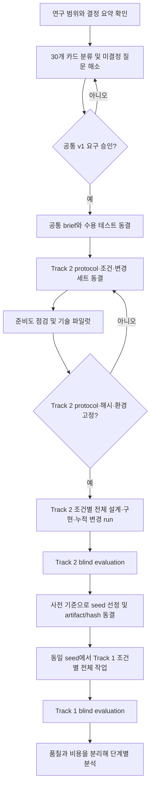
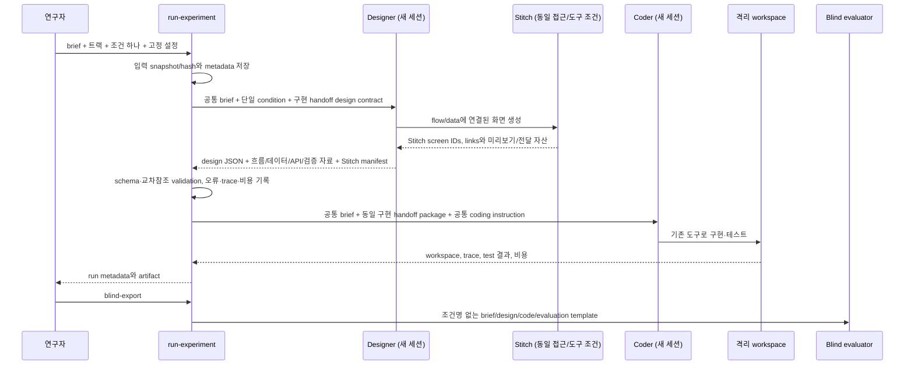

# 연구 실행 플로우와 의사결정 게이트

**상태: 제안 초안 / `NOT READY FOR EXPERIMENT`**

이 문서는 상담 예약 서비스의 요구를 확정하는 문서가 아니라, 확정·검토·실험 준비의 순서를 정의합니다. 확정된 항목은 도메인(1:1 상담 예약), 목표 난이도(L2), 독립된 두 연구 트랙입니다. 세부 서비스 요구와 연구 프로토콜은 아직 미정입니다.

## 전체 흐름

## 단계와 통과 조건

| 단계 | 작업 | 산출물 | 다음 단계로 넘어갈 조건 |
|---|---|---|---|
| 0. 범위 고정 | `00`의 결정과 보관 문서를 구분 | 결정 요약 | 도메인·L2·트랙 독립성 유지 |
| 1. 요구 검토 | `02` 카드마다 출처·검토 상태·결정 등급·연결 관계 검토 | 승인 카드 catalog | v1 요구와 가정·미정·제외 항목이 분리됨 |
| 2. 공통 과제 동결 | 승인 카드만 `04`에서 공통 brief로 정리하고 결과를 시험 가능하게 작성 | brief v1, acceptance tests v1 | brief가 조건·숨은 변경·gold 답안을 포함하지 않음 |
| 3. 연구 프로토콜 동결 | Track 2 protocol 및 Track 1의 seed 의존 절차·비교 단위·평가 규칙 결정 | Track 2 protocol v1, Track 1 seed-selection protocol | Track 1이 선택된 Track 2 결과물에 조건부로 해석됨을 명시 |
| 4. 입력 동결 | 조건 프롬프트, design schema, 공통 agent 입력, hidden tests/changes 버전 고정 | 해시가 있는 입력 bundle | evaluator 전용 파일이 agent-visible 경로와 분리됨 |
| 5. 기술 파일럿 | 제한된 run으로 도구·schema·시험·trace 수집을 확인 | pilot report | 실패 처리와 산출물 검증이 가능함. 파일럿은 연구 결과에 포함하지 않음 |
| 6. Track 2 본 run·평가 | 조건별 fresh run을 반복하고 blind evaluation | 익명 평가 JSON과 run traces | 설정·입력 hash·실패 사유가 기록되고 seed 선정 규칙을 적용할 수 있음 |
| 7. Seed 선택·동결 | 사전 기준을 적용해 Track 2 결과물 하나를 고르고 code/design/Stitch/tests를 hash와 함께 고정 | Track 1 common seed bundle | 결과를 본 뒤 임의로 고르지 않도록 선정 기준과 tie 처리 규칙이 사전 등록됨 |
| 8. Track 1 본 run·평가 | 동결 seed의 동일 복사본에서 각 프로필 조건을 새 세션으로 실행하고 blind evaluation | 익명 평가 JSON과 run traces | 모든 조건이 byte-identical seed에서 시작함 |
| 9. 단계별 분석 | Track 2 비교와 Track 1의 seed 조건부 비교를 따로 분석 | 분석 보고서 | 품질·비용을 분리하고 조건부 해석을 명시함 |

## Run 안에서의 데이터 흐름

전체 실행은 Track 2를 먼저 완료합니다. 사전에 정한 blind evaluation 기준으로 결과물 하나를 선정해 code, 구현 handoff 문서, Stitch 자산, 테스트를 함께 hash 동결합니다. Track 1의 모든 조건은 그 동일 seed bundle의 개별 복사본에서 시작합니다. T1 결과는 해당 T2 seed에 조건을 추가 적용한 효과로 해석합니다.

Designer의 대화 history와 숨은 추론은 Coder에게 전달하지 않습니다. 한 run 안에서도 design과 implementation은 서로 다른 세션입니다. `gemma-agent`의 interactive 대화 기록을 실험 session으로 재사용하지 않습니다.

## Track 2 먼저: Revision-aware Design

1. 초기 brief와 implementation handoff 수준을 승인·동결합니다. 초기 brief에는 후속 변경 내용·candidate ID·gold tests를 넣지 않습니다.
2. 각 Track 2 condition마다 새 Designer/Coder 세션에서 같은 brief를 설계·구현하고 Stitch 화면과 초기 테스트 결과를 보존합니다.
3. V1 완료 후 change를 하나씩 공개합니다. 각 change에서 직전 workspace와 Stitch bundle의 복사본으로 새 Coder 세션을 시작하고 acceptance/regression tests를 다시 실행합니다.
4. 마지막 change 뒤 blind evaluation을 합니다. 선정 기준은 본 run 전에 정하고, 모든 핵심 acceptance/regression 통과를 eligibility gate로 둡니다. 적격 결과 중 primary blind quality criterion으로 seed를 선택하며 token·latency 비용은 별도 보고합니다. 단일 최고 run cherry-pick 여부와 동점 처리 방식도 사전 결정합니다.
5. 선택 결과의 code, flows/data/API, Stitch 자산, tests와 hashes를 Track 1 common seed bundle로 고정합니다.

현재 runner는 변경을 순서대로 누적합니다. 이 순서를 채택하면 Track 2의 주 결과는 누적 revision 대응이 됩니다. change별 독립 효과를 주장하려면 V1 branch 기능과 별도 protocol이 필요합니다.

## 다음: Track 1 개발자 설계 사고 프로필과 보정

1. [13 통합 설계 행동 프로필 자기검토 초안](13_통합_설계행동프로필_자기검토초안.md)에서 반복 확인되는 설계·검토 행동만 evidence로 둡니다. 성격 추정이나 assistant가 먼저 제안한 내용을 근거로 쓰지 않습니다.
2. 참여자가 근거·빈도·맥락·신뢰도와 예상 장점·부작용 가설을 확인하고 수정·승인합니다. 정식 연구 사용 동의·보관 기간·폐기 방법도 결정합니다.
3. 승인 profile version/hash를 고정합니다. 현재 profile 초안은 미검토이며, 05나 실행 입력에 아직 반영하지 않습니다.
4. 모든 T1 condition에 Track 2에서 동결한 완전히 같은 seed bundle과 같은 refinement task를 제공합니다. 조건별 새 Designer/Coder 세션으로 설계 검토·개선·구현·테스트를 수행합니다. 바뀌는 것은 profile 적용 정책입니다.
5. 결과는 선택된 T2 seed에서의 incremental profile effect로 해석합니다. 단일 참여자의 결과를 개발자 일반에 일반화하지 않습니다.

## 통제와 기록

- brief, condition, schema, 공통 prompt의 snapshot과 SHA-256을 보존합니다.
- 모델 파일/식별자, llama.cpp 버전과 실행 옵션, chat template, server context, temperature, seed, 출력 token budget, agent step budget을 조건 간 고정·기록합니다. 현재 harness는 모델 ID와 `--context-length` 라벨은 저장하지만 server context나 build 정보를 자동 탐지하지 않으므로, 서버 설정에서 확인해 입력해야 합니다.
- 같은 비교 블록의 run은 같은 seed schedule을 사용하고 조건 순서는 사전 지정한 무작위/균형 순서로 실행합니다. 현재 CLI 반복은 한 condition을 연속 실행하므로 조건 순서 무작위화는 별도 run 계획으로 관리해야 합니다.
- tool availability, starter workspace hash, Python/runtime, 테스트 명령과 테스트 버전을 고정합니다.
- 구현 handoff 산출물 요건, Stitch 접근·버전·도구 권한·내보내기 경로와 Coder handoff 규칙을 조건 간 고정합니다. 화면 수나 구현 결과를 미리 같게 강제하지 않고, 같은 완성 기준 아래 차이를 평가합니다.
- JSON schema 오류는 기록만 하고 자동 수정하지 않습니다.
- 평가 점수와 token/latency/tool cost를 따로 분석합니다.

## 지금 통과하지 못한 게이트

- `04`는 v1 요구를 포함하지 않고 `readyForRun=false`입니다.
- `05`와 `06`의 조건·평가 기준은 초안입니다.
- `07`의 change 후보는 승인되지 않았고, hidden gold tests도 없습니다.
- 실행 harness는 위 JSON 템플릿의 `readyForRun`을 읽어 실행을 막지 않습니다. 실제 study를 시작하기 전에 사람이 이 게이트를 확인하고, 추후에는 기계 판독 readiness manifest를 추가하는 것이 안전합니다.
- 현재 harness의 agent tool 목록에는 Stitch 생성/조회 기능이 없습니다. 시각 산출물을 조건별로 만들려면 Stitch 도구 연동, 또는 조건 블라인드 수동 절차를 파일럿 전에 결정하고 같은 절차를 모든 조건에 제공해야 합니다.
- 2026-10-04의 실제 모델 smoke run은 임시 태스크 API로 pipeline을 확인한 기술 시험입니다. 상담 예약 서비스 요구를 평가하지 않았으므로 연구 데이터가 아닙니다.
