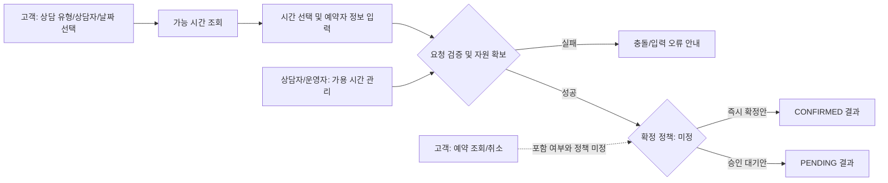
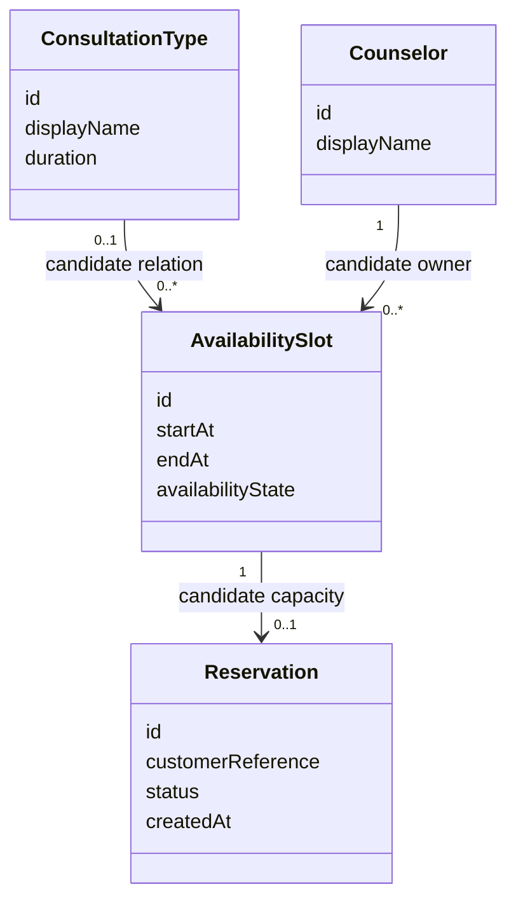
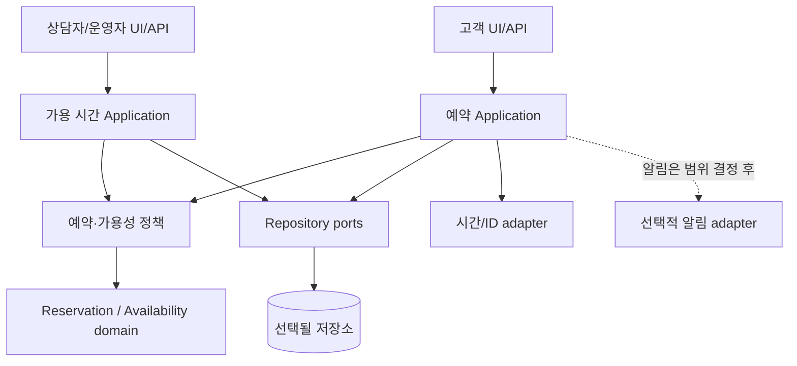

# 1:1 상담 예약 서비스 공통 설계 수준 초안

**상태: 도메인과 L2 목표만 확인됨. 아래 흐름·모듈·상태는 설계 후보이며 요구사항이 아닙니다.**

두 연구가 사용할 공통 과제의 설계 수준을 맞추기 위한 문서입니다. `02`의 설계 카드와 `03`의 catalog가 검토되기 전까지 이 문서를 production 명세나 agent 입력으로 사용하지 않습니다.

## 설계 목표와 L2 범위

서비스는 단순 CRUD를 넘어 여러 사용자 흐름, 지속되는 예약 상태, 가용 시간과 예약 사이의 규칙 연결을 가져야 합니다. 동시에 실제 결제, 복잡한 권한 체계, 다수의 외부 서비스 연동이 결과 차이를 지배하지 않도록 범위를 제한하는 것이 L2의 제안입니다.

`00`에서 말하는 **L2는 소프트웨어 과제의 복잡도 등급**입니다. 여러 단계의 사용자 흐름, 저장 상태, 연관된 모듈과 테스트 가능한 결과가 있는 중간 규모를 뜻하며, 아키텍처의 레이어를 가리키지 않습니다.

설계 산출물에는 별도 숫자 등급을 붙이지 않고 **구현 handoff 기준**으로 부르겠습니다. 두 연구의 모든 조건에서 이 기준을 동일하게 요구합니다. 비교 대상은 설계의 분량이나 전달 형식이 아니라, 조건에 따른 설계 판단과 그 결과입니다.

구현 handoff 기준은 각 흐름의 데이터·규칙·화면·검증까지 구현자가 추가 구두 설명 없이 착수할 수 있는 상태입니다. 이는 제품 요구가 모두 확정됐다는 뜻은 아닙니다. 미결정 사항은 구현자가 임의로 확정하지 않도록 `OPEN`으로 표시하고, 영향과 후속 질문을 함께 넘깁니다. 승인되지 않은 가정은 확정 요구처럼 표현하지 않습니다.

L2 자체는 확정됐지만, 아래 항목은 아직 결정되지 않았습니다.

- 상담 분야, 고객에게 보이는 상담자/서비스 카탈로그
- 상담자와 운영자의 역할 분리 및 시간 관리 방식
- 예약 즉시 확정 또는 승인 대기
- 고객 로그인/예약번호 접근, 취소·변경 허용 조건
- 상담자 수와 시간대별 용량, 중복 예약 규칙
- 예약 시 수집 정보, 저장 기간, 민감 정보 처리
- 시간대 기준, 저장소, 실행 환경, 시험용 데이터

## 사용자 흐름 후보

| Flow 후보 | 확인할 결과 | v1 상태 |
|---|---|---|
| 상담 조건과 가능 시간 탐색 | 선택한 날짜·상담자에 맞는 시간 목록 | 후보, 세부 검색축 미정 |
| 예약 제출 | 유효성 검사, 시간 재확인, 중복/충돌 처리 | 후보, 확정 정책 미정 |
| 결과 표시 | 성공·대기·충돌·입력 오류를 구별 | 후보 |
| 예약 조회·취소 | 권한 확인, 취소 가능 시점, 상태 변경 | 포함 여부 미정 |
| 상담자 가용 시간 관리 | 시간 등록·닫기, 기예약 시간 변경 정책 | 역할과 운영 방식 미정 |

## 도메인 모델 후보

연결과 수량은 제안일 뿐입니다. 특히 한 슬롯의 정원, 상담 유형과 상담자 관계, 고객 identity, 예약 레코드의 개인정보 필드는 승인 전입니다.

## 후보 모듈 경계

설계 단계에서는 `UI/API adapter`, 예약/가용 시간 use case, domain policy, persistence port 정도의 책임 경계를 설명합니다. 실제 프레임워크, 데이터베이스, 배포 구성, 알림·결제 연동은 요구가 없으면 고정하지 않습니다. 숨은 변경을 견디도록 막연한 추상화 계층을 추가하는 것도 피합니다.

## 예약 상태와 핵심 규칙 후보

확정 정책이 두 안 중 무엇인지 사용자 검토가 필요합니다.

| 정책 대안 | 생성 시 상태 | 후보 전이 | 열어 둘 질문 |
|---|---|---|---|
| 즉시 확정 | `CONFIRMED` | `CONFIRMED → CANCELLED` | 고객 취소 cutoff와 상담자 취소 권한은? |
| 승인 대기 | `PENDING` | `PENDING → CONFIRMED / REJECTED`, 이후 `CANCELLED` 가능 여부 | 누가 승인하고 응답 지연·거절을 어떻게 처리하는가? |

후보 invariant는 **요청 제출 시점에 현재 가용성을 다시 검증**하는 것입니다. 같은 상담자·시간의 활성 예약을 하나로 제한하는 정책은 사용자 예시에서 왔지만 아직 승인되지 않았습니다. 경쟁 요청을 처리하는 방식과 persistence atomicity도 저장소·실행 환경을 정한 뒤 acceptance test로 고정합니다.

## Design 단계가 내야 하는 수준

구현 handoff 묶음은 사람이 보는 문서와 Coder가 바로 전달받을 구조화 파일을 함께 갖습니다.

1. **흐름 계약:** 모든 단계에 flow ID, 역할, 시작 조건, 사용자 입력, 검증, 읽거나 쓰는 데이터 필드, 상태 변경, 다음 화면/결과, 실패·대체 경로, 완료 조건을 연결합니다.
2. **필드 수준 데이터 사전:** 필드 ID/이름, 타입, 필수 여부, 출처, 허용 값·형식, 생성·수정 주체, 노출 범위, 민감도, 보존·삭제 정책을 기록합니다. 아직 결정되지 않은 보존·접근 규칙은 `OPEN`으로 둡니다.
3. **도메인 규칙:** entity 관계, cardinality, 상태 전이, invariant, 동시 요청과 재시도 정책을 정의합니다.
4. **API 계약:** 각 동작의 method/path, request/response 예시, 성공·오류 상태와 해당 flow/data ID를 연결합니다. 구현 언어나 프레임워크는 brief가 요구하지 않으면 고정하지 않습니다.
5. **화면 계약과 Stitch 산출물:** 화면 ID를 flow 단계에 연결하고, 화면마다 사용 데이터 필드, 주요 조작, 기본·loading·empty·validation error·server error·success·conflict 상태와 화면 전환을 명시합니다. Stitch에서 만든 각 화면의 링크/ID, 버전, 내보낸 미리보기 또는 전달 가능한 디자인 자산을 manifest로 묶어 Coder에 전달합니다.
6. **검증 추적성:** acceptance criterion마다 ID를 부여하고 관련 flow, data field, API, Stitch 화면 및 검증 테스트를 연결합니다.
7. **설계 결정 ledger:** 각 결정에 `ACCEPTED / PROVISIONAL / ASSUMPTION / OPEN / REJECTED`, 근거, 영향 대상, 후속 질문을 기록합니다. Track 2 조건이 쓰는 안정도·재검토 필드는 별도 condition artifact에 둡니다.

권장 handoff 묶음은 `design-spec.json`, 사람이 검토할 `flows-and-data.md`, `api-contract.md`, `acceptance-map.md`, 그리고 `stitch/manifest.json` 및 화면 산출물입니다. 같은 내용을 여러 형식에 복제해 불일치시키지 말고 ID로 상호 참조합니다. 실험 투입 전에는 이 구성에 맞춰 `design-specification.schema.json`을 버전업하고 schema validation을 켭니다.

**Stitch 접근은 조건 간 통제 변수입니다.** 각 조건에 동일한 Stitch 기능·버전·도구 권한·내보내기 경로를 제공하고, 자동화한다면 프롬프트·호출·재시도·소요 시간·비용을 기록합니다. 연구자가 수동으로 보정한다면 조건을 모른 채 같은 규칙으로 보정하고 작업 시간과 수정 이력을 기록합니다. 조건별로 도구 접근이나 사람의 보정 정도가 달라지면 설계 전략 외 요인이 섞입니다.

Track 2에서는 이 결과에 카드 ID, maturity, rationale, affected card IDs, revisit condition을 덧붙이는 별도 ledger를 시험할 수 있습니다. Track 1에서는 승인된 개발자 profile이 어떤 검토 행동을 바꾸었는지 traceable하게 하되 profile 추측을 제품 요구로 섞지 않습니다.

## 평가 설계에 연결할 검증 후보

- **기능:** 승인된 고객 흐름의 완료와 결과 상태
- **규칙:** 선택 시간의 최신 가용성, 충돌, 상태 전이
- **실패/경계:** 잘못된 입력, 없는 예약, 재시도, 시간 경계
- **회귀:** 초기 acceptance tests를 후속 변경 후 다시 실행
- **구조:** 의존 경계, 중복 규칙, 불필요한 추상화와 변경 영향

이 목록은 test 후보입니다. gold test의 예상 결과와 점수 rubric은 v1 요구를 승인하고 나서 결정합니다.
